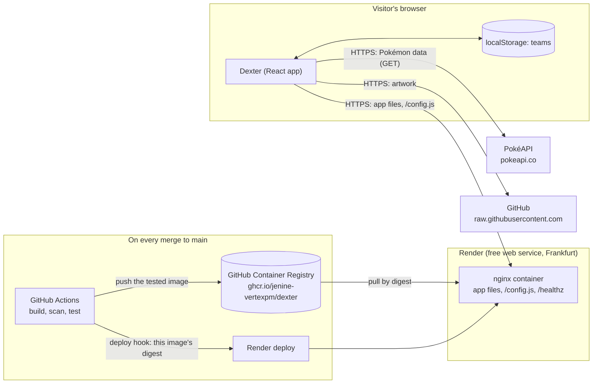

# Dexter

[](https://github.com/jenine-vertexpm/dexter/actions/workflows/ci.yml?query=branch%3Amain)
[](https://github.com/jenine-vertexpm/dexter/actions/workflows/smoke.yml)

A Pokédex and team builder built with React, TypeScript and Vite, using the public [PokéAPI](https://pokeapi.co/docs/v2).

- **CI** shows whether lint, type checks, all tests, the image build, the vulnerability scan and the browser tests pass on `main`.
- **API smoke test** shows the result of the latest *daily* check that the live PokéAPI still behaves the way Dexter expects. Manual runs (such as the deliberate "test the alarm" failure) don't change it. See [`docs/TESTING.md`](docs/TESTING.md).

> **Live:** <https://dexter-4tho.onrender.com>. It's on a free plan, so after 15 minutes without visitors it sleeps, and the first visit after that can take about a minute to load ([Known limitations](#known-limitations)).
>
> **Status:** M1–M5 are done: Dexter is deployed over HTTPS, from the same Docker image CI tested, and every merge to `main` deploys automatically. Two manual checks from the M5 plan are still outstanding ([Known limitations](#known-limitations)).
>
> - **Pokémon list:** one entry per species, 20 per page, with search by name and a filter for one or two types. The page, search and types are kept in the URL, so a list view can be reloaded, bookmarked or shared.
> - **Detail page** (`/pokemon/<name>`): artwork, number, types, height and weight, base stats, abilities (hidden ones marked), description, evolution chain, type matchups, and links to the previous and next Pokémon.
> - **Teams** (`/teams` and `/teams/<id>`): build named teams of up to 6 Pokémon, see each team's strengths and weaknesses, and export or import a team as a file. See [Teams](#teams) below.
> - The list, detail and team pages show a loading message while data loads, and an error message with a Retry button if a request fails. On the detail page, the evolution chain and type matchups load separately, so if one fails the rest of the page still shows. The same goes for the analysis on a team page.
> - **Hardened (M4):** security headers and a strict Content Security Policy, checked on every pull request; automated accessibility checks (axe); the request budget checked automatically; dependency and image scanning (Trivy, Dependabot); a daily test against the live PokéAPI. See [`SECURITY.md`](SECURITY.md) and [`docs/TESTING.md`](docs/TESTING.md).

## Teams

- **Create, rename and delete teams** on the Teams page. A team name is 1 to 30 characters and must be unique. Names that differ only in capitals or in spaces at the start or end count as the same, so "Rain Team" and " rain team " clash. You have to confirm before a team is deleted.
- **Add Pokémon** from the list or from a Pokémon's page: choose a team in **Add Pokémon to:**, then press the add button. A team holds at most 6 Pokémon, and each species only once.
- **On a team's page** you can remove members, change their order with **Move up** / **Move down**, and give each member an optional nickname: 1 to 12 letters (from any language), numbers and spaces.
- **Team analysis:** for each of the 18 attacking types, how many members are weak to it, resist it, or are immune to it. A type is marked **⚠ Shared weakness** when 3 or more members are weak to it and none resist it or are immune. The analysis also shows the team's average for each base stat.
- **Export team** saves the team as a small `.json` file. **Import a team** (on the Teams page) reads a file like that back and adds it as a new team. Files over 16 KB, files that aren't Dexter team files, files that name a Pokémon species that doesn't exist, and files that break the rules above are rejected with a list of the problems. An import never changes your existing teams. If a team with the same name already exists, the import is rejected: rename or delete that team first.

### Where your teams are saved

Dexter has no server and no accounts. Your teams are saved **only in this browser, on this device**, in its local storage (`localStorage`, under the key `dexter.teams`). In practice:

- **They survive reloads and restarts.** Closing the tab or the browser doesn't delete them.
- **Clearing your browser data for the site deletes them.** Safari may also delete them by itself if you haven't visited the site for 7 days.
- **Private windows don't keep them.** Teams made in a private (incognito) window are deleted when the last private window closes.
- **They don't follow you to another browser or device.** They're also tied to the site's address, so the app opened at a different address or port starts with no teams.
- **If your browser blocks storage**, you can still build teams, but a notice warns that they will be lost when you close the tab.
- **Space is limited** to about 5 MiB per site. A team takes very little of that, but if a save ever fails because storage is full, a notice says so. Your latest change is kept in the open tab but isn't saved, so export your teams to keep a copy.
- **If the saved data is damaged** or was saved by a newer version of Dexter, a notice explains the problem and nothing is changed or overwritten until you choose what to do. You can download a copy of the saved data first. If only some teams are damaged, the others are shown and you can keep them.

**The backup is Export.** To keep a copy of a team, or to move it to another browser or device, export it and import the file there.

### Two open tabs

If Dexter is open in two tabs, a change saved in one tab shows up in the other. There's no merging, though: **the last save wins.**

- If both tabs change teams at nearly the same moment, the later save replaces the earlier one, and the earlier change is lost.
- A half-filled form (for example a nickname you're typing) isn't cleared when the other tab saves. When you submit it, it applies to the updated teams. If the other tab deleted that team, you'll see "This team no longer exists."

### Other limitations

- New team ids are made with the browser's `crypto.randomUUID()`, which only works on secure pages: `https://` addresses and `localhost`. The usual ways of running the app (the commands below, or Docker on `localhost`) are all secure.

## Request budget

PokéAPI is a free public service, so Dexter keeps its requests low ([fair use](https://pokeapi.co/docs/v2#fairuse)). The budget: a cold load of the first list page makes **no more than 25 requests**, and returning to a page already seen makes **none**.

Only requests to `pokeapi.co` count towards it. The artwork comes from GitHub's servers (`raw.githubusercontent.com`), not from PokéAPI, so it is counted separately below.

**Cold and returning visits.**

- **Cold visit:** the app starts with nothing loaded. The first list page loads the species index (one request, used for paging and search) and one Pokémon per card (20).
- **Returning:** everything loaded is kept in the app's memory for the rest of the visit and is never fetched again. Going back to a page, or pressing Back after opening a Pokémon, uses what is already there.
- **Reload or new tab:** that memory is emptied, so a reload or a new tab is a new cold visit.

### Checked automatically

`e2e/request-budget.spec.ts` runs with the other browser tests (`npm run e2e`) on every pull request, against the production container. PokéAPI answers come from recordings (see `e2e/fixtures/README.md`), but the app makes exactly the requests it would make to the live API, so the counts are the same.

| Check | Assertion | Result today |
|---|---|---|
| Cold load of the first list page | at most 25 PokéAPI requests, and none for the same address twice | 21 |
| Page 2, then back to page 1 | no new PokéAPI requests | 0 |
| Open a Pokémon, then Back to the list | no new PokéAPI requests | 0 |

### Measured live

- **Date:** 9 November 2026. Repeated the same day at the end of M4 on the final code (commit `f268e1f`): the same request counts (21 / 20 / 9 cold; 0 back on page 1), and the same transferred sizes to within 1 kB.
- **Browser:** Chromium 156.0.8078.4 (the version bundled with Playwright), in a 1280×720 window.
- **Set-up:** the production container (`docker compose up --build`, http://localhost:8080) talking to the live PokéAPI and artwork servers.
- **Method:** each request was logged through the Chrome DevTools Protocol, which is where the DevTools Network tab gets its data. The browser cache was disabled, as in DevTools' "Disable cache" option. A Playwright script did the clicking and typing.
- **Repeats:** the measurement was run twice. The first run is shown; the second matched it apart from small differences in bytes. "Transferred" means bytes over the network, including headers, as DevTools reports it.

| | PokéAPI | Artwork | App files (HTML, JS, CSS) | Total |
|---|---|---|---|---|
| **Cold first page:** requests | **21** | 20 | 9 | 50 |
| **Cold first page:** transferred | 144 kB | 3.1 MB | 416 kB | 3.7 MB |
| **Back to page 1** (after page 2): requests | **0** | 0 | 0 | 0 |

- **Artwork is lazy-loaded:** the browser only fetches images that are on screen or about to be, so the artwork count depends on the window size.
- **Back on page 1 there were no artwork requests either,** even with the cache disabled. The browser kept the images it had already shown in memory.
- **Since M5 there is one more app file:** `/config.js`, the runtime configuration ([Configuration](#configuration)). Counted again on the live site on 12 November 2026 (commit `ff908ac`, cache disabled, 1280×720 and 360×740): **21** PokéAPI requests, 20 artwork, **10** app files. Sizes weren't measured again; `/config.js` is under 100 bytes.

**Typing "pikachu" quickly** into the search box (100 ms between keys), after the first page had loaded. This is for information only; it is not part of the budget.

| | Run 1 | Run 2 |
|---|---|---|
| PokéAPI requests started | 30 | 30 |
| … cancelled | 26 | 15 |
| … completed | 4 | 15 |
| Artwork requests | 4 | 9 |

Each letter updates the results straight away. When a letter changes the list, the cards that disappear stop waiting, and their unfinished requests are cancelled (brief §3.2: requests that are no longer needed are cancelled). How many finish first depends on how fast PokéAPI answers, hence the difference between runs. In both runs the search ended on the one card, pikachu. No change was made: about 30 short requests for a whole word is well within fair use.

## Bundle size

Each page's code is downloaded only when that page is first opened (route-level code splitting, M4 H2). Before splitting, the whole app was one 427 kB JavaScript file.

Measured with `npm run build` on 9 November 2026, on commit `f268e1f` (the final M4 app code). "gzip" is the compressed size Vite reports, close to what travels over the network.

**What each page needs on a first visit** (JavaScript only: the main chunk, plus that page's chunk and the shared chunks it imports):

| Page | Raw | gzip |
|---|---|---|
| Pokémon list (`/`) | 406.6 kB | 127.5 kB |
| Pokémon detail (`/pokemon/<name>`) | 408.8 kB | 128.1 kB |
| Teams (`/teams`) | 410.7 kB | 128.8 kB |
| Team detail (`/teams/<id>`) | 414.8 kB | 130.6 kB |
| Not found | 384.2 kB | 118.9 kB |

**The chunks**

| Chunk | Raw | gzip | Contains |
|---|---|---|---|
| `index` (main) | 383.8 kB | 118.7 kB | React, React Router, TanStack Query, zod, the API client and the team store: what every page needs |
| `pokeApiQueries` | 15.4 kB | 5.5 kB | the PokéAPI queries and data mapping, shared by the pages that load Pokémon |
| `TeamDetailPage` | 7.4 kB | 2.7 kB | the team page |
| `teamFile` | 6.6 kB | 2.7 kB | team file export and import (Teams and team pages) |
| `PokemonDetailPage` | 5.7 kB | 1.9 kB | the detail page |
| `TeamsPage` | 4.9 kB | 1.9 kB | the Teams page |
| `PokemonListPage` | 4.8 kB | 2.0 kB | the list page |
| `TeamPicker` | 2.3 kB | 1.1 kB | "Add Pokémon to:" and the add buttons |
| `matchups` | 1.1 kB | 0.6 kB | type matchups (detail page and team analysis) |
| `NotFoundPage` | 0.3 kB | 0.2 kB | the not-found page |
| `battleTypes` | 0.2 kB | 0.2 kB | the list of 18 types |
| CSS (7 files) | 8.5 kB in total | 3.5 kB in total | the shared styles, plus one file per page or shared part |

The main chunk is most of every page's download. It's the libraries Dexter is built on, and they're downloaded once: every later page only adds its own few kB. All files except `index.html` have a fingerprint in their name and are cached by the browser for a year. `index.html` is checked on every visit, so a new version is picked up straight away.

## Requirements

- [Node.js](https://nodejs.org/) 20.19+ or 22.12+ (developed on Node 22)
- npm (comes with Node.js)
- [Docker](https://www.docker.com/), with Compose, to run the production container and the browser tests (`npm run e2e`)

## Getting started

Install the dependencies (run once, and again whenever `package.json` changes):

```bash
npm install
```

Start the development server:

```bash
npm run dev
```

Then open the address it prints (usually http://localhost:5173) in your browser. The page reloads automatically when you save a file.

## Available commands

| Command | What it does |
|---|---|
| `npm run dev` | Starts the local development server |
| `npm run typecheck` | Checks the TypeScript types without building (strict mode) |
| `npm run build` | Type-checks, then builds a production version into `dist/` |
| `npm run preview` | Serves the built `dist/` folder locally to try the production build |
| `npm run lint` | Runs the linter (oxlint) |
| `npm test` | Runs the unit and component tests once (Vitest). They use a fake PokéAPI, so they never call the real one |
| `npm run test:watch` | Runs those tests again each time you save a file |
| `npm run e2e` | Runs the end-to-end browser tests (Playwright) against the production container, with recorded PokéAPI answers. Starts the container with `docker compose up --build` if it isn't already running |
| `npm run e2e:record` | Re-records the PokéAPI answers the end-to-end tests use, from the live API. Run by hand only, when the API has changed (see [`e2e/fixtures/README.md`](e2e/fixtures/README.md)) |
| `npm run smoke` | Checks that the **live** PokéAPI still behaves the way Dexter expects (also runs daily in GitHub Actions) |
| `docker compose up --build` | Builds the production image and serves it at http://localhost:8080, with the real security headers |

What each kind of test covers, and what isn't tested and why, is in [`docs/TESTING.md`](docs/TESTING.md).

## Architecture

Dexter is a single-page app: everything runs in the visitor's browser. The server is nginx in a container, serving Dexter's own files and nothing else. The browser fetches Pokémon data from PokéAPI and artwork from GitHub directly, so neither passes through Dexter's server.



- **The browser** runs the app, keeps teams in `localStorage`, and fetches data and artwork itself. The Content Security Policy allows only those two outside addresses ([`SECURITY.md`](SECURITY.md)).
- **The container** (nginx, non-root, port 8080) serves the built files, `/config.js` (this environment's settings), `/version.txt` (the commit it was built from) and `/healthz`. It has no backend code and never calls PokéAPI.
- **Delivery:** CI builds the image once, tests it, pushes it to GitHub Container Registry and tells Render to run that exact image ([How to deploy](#how-to-deploy)).

## Environments

There are two environments: **local** and **production**. They run the **same image**; only the two settings below differ, and they're given to the container when it starts, never built into the image.

| | Local | Production |
|---|---|---|
| Where | your machine: `docker compose up --build`, http://localhost:8080 | Render: <https://dexter-4tho.onrender.com> |
| Image | built locally from this repository | the image CI built and published, `ghcr.io/jenine-vertexpm/dexter` |
| Settings come from | [`compose.yaml`](compose.yaml), which uses the defaults below unless a `.env` file or your shell sets them | [`render.yaml`](render.yaml) (`envVars`) |
| `DEXTER_ENVIRONMENT` | `local` | `production` |
| `DEXTER_API_BASE_URL` | `https://pokeapi.co/api/v2` | `https://pokeapi.co/api/v2` |
| HTTPS | no (`http://localhost`) | yes, managed by Render |

Two other places run Dexter, but they aren't environments:

- **`npm run dev`** (the development server) serves `/config.js` itself, with the local values ([`vite.config.ts`](vite.config.ts)). It sends none of the security headers.
- **CI** starts the image as `ci`, and a second copy with a made-up API address as `demo`, to prove one image follows its configuration ([`docs/TESTING.md`](docs/TESTING.md)).

The environment's name is shown in the footer of every page ("Environment: production").

### Configuration

Dexter has two settings, both **required**: the image has no defaults, so a container started without them refuses to start. [`.env.example`](.env.example) documents both.

| Variable | What it does | Rule |
|---|---|---|
| `DEXTER_API_BASE_URL` | Where the app fetches Pokémon data. Its origin (`https://pokeapi.co`) also becomes the only address the CSP's `connect-src` allows | `https://` only, lower-case host, optional port, a path of letters, digits and `. _ ~ / -`, no trailing slash |
| `DEXTER_ENVIRONMENT` | The name shown in the footer | 1 to 20 lower-case letters, digits or dashes, starting with a letter |

**How it works:** when the container starts, [`docker/05-dexter-config.envsh`](docker/05-dexter-config.envsh) checks both values, then nginx writes them into a one-line `/config.js` and into the CSP header. `index.html` loads `/config.js` before the app, and the app checks the values again ([`src/config.ts`](src/config.ts)). Vite's `import.meta.env` couldn't be used: Vite writes those values into the JavaScript when the app is *built*, so every environment would need its own image.

**If a value is wrong:**

- **Missing or breaking the rule:** the container prints `Dexter configuration error: …` and stops before serving anything. On Render, the new deploy never becomes healthy and the previous version keeps serving.
- **`/config.js` fails to load in the browser:** the app shows "Dexter isn't configured correctly" instead of a blank page.

Why the rules are this strict (so `/config.js` can't carry injected code): [`SECURITY.md`](SECURITY.md) section 7.1.

**Locally:** `docker compose up --build` works with no `.env` file. To change a value, copy `.env.example` to `.env` (it's never committed) and edit it.

## Health check

`/healthz` answers `ok` (HTTP 200). nginx answers it **itself**: it doesn't load the app and never calls PokéAPI. Render uses it as the service's health check ([`render.yaml`](render.yaml), `healthCheckPath`), as does `compose.yaml` locally.

**Why it must not depend on PokéAPI:** Render acts on a failing health check. During a deploy, it only switches traffic to the new version once the health check passes. On a running service, Render stops sending traffic to an instance that fails its health check for 15 seconds, and restarts it after 60 seconds (Render docs, *Health checks*). If `/healthz` checked PokéAPI, a PokéAPI outage would make Render take Dexter offline and keep restarting it. That would happen even though Dexter could still show teams, cached data and a clear "Could not reach PokéAPI" message with Retry, and restarting can't fix someone else's outage. It would also send PokéAPI a request on every health check. The health check answers one question only: "is *our* server up?"

`e2e/runtime-config.spec.ts` checks `/healthz` in CI, including in a container whose API address doesn't exist, and on the live site after every deploy. Pointing the live service at an unreachable API to watch it stay healthy (the M5 plan's "PokéAPI-down check") hasn't been done yet.

## Infrastructure

The deployed service is described in [`render.yaml`](render.yaml), a [Render Blueprint](https://render.com/docs/infrastructure-as-code): Render's own infrastructure-as-code format, used instead of Terraform because Render's Terraform support can't create free services (decision log, 2026-11-09 "Hosting").

**What it declares:** one free web service, `dexter`, in Render's Frankfurt region. It runs the image CI published to GitHub Container Registry (`ghcr.io/jenine-vertexpm/dexter`); Render never builds anything. It also sets the production runtime configuration (`DEXTER_ENVIRONMENT=production`, `DEXTER_API_BASE_URL`), the port nginx listens on (`8080`), and `/healthz` as the health check.

**How it's applied:** the Blueprint was created once in the Render dashboard from this file. **Auto Sync is off**, so a change to `render.yaml` takes effect only after it's merged *and* someone reviews it in the Render dashboard and presses **Manual Sync**. The Render account has **no payment method**, so it can't be billed: going over the free limits suspends the service until the next month instead.

## How to deploy

**Merging to `main` deploys.** There's nothing to do by hand. On every push to `main`, [`.github/workflows/ci.yml`](.github/workflows/ci.yml) runs:

1. **`lint-and-typecheck`** and **`image-and-e2e`**: the same checks as on a pull request. The image is built **once**, scanned by Trivy and tested.
2. **`publish`**: pushes **that same image** (no rebuild; its ID is checked) to GitHub Container Registry, tagged `sha-<commit>` and `main`, and records its **digest** (`sha256:…`, the fingerprint of that exact image).
3. **`deploy`**: calls Render's deploy hook with the image's digest, so Render runs exactly the image that was tested. It waits until `https://dexter-4tho.onrender.com/version.txt` shows the merged commit, then checks the live site's security headers and configuration. The job summary shows the URL, commit and digest.

If any step fails, nothing after it runs. If the new version never becomes healthy, Render keeps the previous one serving and `deploy` fails after 15 minutes. If the live checks fail, the new version *is* already live: the run turns red, and the fix goes through a new pull request.

**Changing the infrastructure** (region, plan, settings, health check): edit [`render.yaml`](render.yaml) in a pull request and merge it. Then, in the Render dashboard, open the Blueprint, review the changes and press **Manual Sync**. Auto Sync is off on purpose, so nothing changes on Render until someone reviews it.

**Rolling back:**

- **Render dashboard:** the service's **Deploys** page → **Rollback** on an earlier successful deploy. It reuses that deploy's image (by digest), so nothing is rebuilt. Render's docs say a rollback from the dashboard also turns off auto-deploy for the service. Dexter doesn't use auto-deploy (CI deploys through the hook), but a deploy from CI after a rollback hasn't been tried yet.
- **Or re-run an older `deploy` job** in GitHub Actions, which deploys that run's digest again. Not tried yet.
- Either way, the next merge to `main` deploys the newest image again. To keep a bad change from coming back, revert it in a pull request.

**Rotating the deploy hook** (the only secret): regenerate it in Render, then update the repository secret `RENDER_DEPLOY_HOOK`. The step-by-step is in [`SECURITY.md`](SECURITY.md) section 7.2. The site's address is the repository variable `PRODUCTION_URL` (not secret).

## Image size

| | Size | Measured with |
|---|---|---|
| **Download (compressed)** | **28.2 MB** | GHCR manifest for `ghcr.io/jenine-vertexpm/dexter:main` (sum of the layers); `docker images` "CONTENT SIZE" |
| **Unpacked** | **about 72 MB** | `docker history` (sum of the layers) |
| On disk after `docker pull` | 99.8 MB | `docker images` "DISK USAGE": the unpacked layers *plus* the compressed copy Docker keeps |

Measured on 12 November 2026, image `sha256:2eec9e9b…` (commit `ff908ac`).

**Why it's that size:** almost all of it is the base image, `nginxinc/nginx-unprivileged:1.30.6-alpine3.24` (25.6 MB compressed):

| Part | Unpacked |
|---|---|
| Alpine Linux | 9.1 MB |
| nginx and the modules the official image ships | 55.3 MB |
| `apk upgrade`: Alpine security fixes newer than the base image (SECURITY.md A03) | 6.5 MB |
| **Dexter's built app** (`dist/`, including `version.txt`) | **0.5 MB** |
| Dexter's nginx templates and start-up script | under 0.1 MB |

The multi-stage build keeps Node, `node_modules` and the source code out of the final image: they're only in the build stage. The app itself is about half a megabyte. A smaller image would mean a different server than the official nginx image, which isn't worth the trade for a few MB.

## Costs

Dexter costs **R0**, with no payment card on any account.

| What | Where | Cost |
|---|---|---|
| Running the site | Render Free web service: 750 instance-hours a month, enough for one service all month | R0 |
| Traffic from Dexter's server | Render: only Dexter's own files (about 0.42 MB on a cold first visit; PokéAPI and artwork go straight to the browser). 5 GB a month free | R0 |
| Building | GitHub Actions (public repository); Render builds nothing | R0 |
| Storing and pulling the image | GitHub Container Registry, public package | R0 |
| HTTPS certificate and address | `*.onrender.com`, managed by Render | R0 |

**At the limits:** the Render account has **no payment method**, so going over the free limits can't produce a bill. Render suspends the service until the next month instead. **Never add a payment method:** that would turn suspension back into billing.

## Known limitations

**From the free hosting:**

- **Cold start:** after 15 minutes without visitors, the service sleeps. The next visit wakes it, which Render says takes about a minute (Render docs, *Free instances*). Later visits are fast again. Not yet timed on Dexter itself: an attempt on 12 November 2026 found the service still awake after 21 minutes without our own traffic.
- **5 GB of outbound traffic a month.** A cold visit is about 0.42 MB of Dexter's own files, so roughly 12,000 cold visits. Beyond that, the site is offline until the 1st of the next month.
- **Render may restart free instances at any time**, and says the free plan isn't for production use. Nothing is lost: Dexter keeps no data on the server.

**From the design:**

- **No staging environment:** only local and production (the brief asks for two). The same checks run on the image before it's published, and again on the live site after each deploy.
- **The live checks run after the deploy,** so a problem they find is already live. There's no automatic rollback ([How to deploy](#how-to-deploy)).
- **A Render Blueprint instead of Terraform:** Render's Terraform provider can't create free services, so the infrastructure is defined in `render.yaml`, Render's own format ([Infrastructure](#infrastructure)).
- Teams live only in one browser on one device ([Where your teams are saved](#where-your-teams-are-saved)). Security limitations are listed in [`SECURITY.md`](SECURITY.md) section 6.

**Not yet verified:** two manual checks from the M5 plan (step R7) are still outstanding:

- the **PokéAPI-down check**: point the live service at an unreachable API and confirm the health check stays green;
- the **Billing check**: confirm in the Render dashboard that no payment method is on file.

## Project documents

This project was built for a two-week AI-assisted React engineering challenge; the brief itself is not included in this repository.

- [`SECURITY.md`](SECURITY.md) – security: the OWASP Top 10:2025 for Dexter, headers and CSP, known limitations, and how to report a vulnerability
- [`docs/TESTING.md`](docs/TESTING.md) – test strategy: what each level of testing covers, why E2E uses recordings and the smoke test the live API, and what isn't tested
- [`docs/vulnerability-triage.md`](docs/vulnerability-triage.md) – how vulnerability findings and Dependabot pull requests are handled
- [`docs/DECISIONS.md`](docs/DECISIONS.md) – decision log
- [`docs/plans/M2.md`](docs/plans/M2.md) – M2 plan: browse and detail
- [`docs/plans/M3.md`](docs/plans/M3.md) – M3 plan: teams (decisions D8–D18, storage format, team file format and import rules)
- [`docs/plans/M4.md`](docs/plans/M4.md) – M4 plan: hardened (decisions D19–D29: E2E, headers and CSP, scanning, smoke test)
- [`docs/plans/M5.md`](docs/plans/M5.md) – M5 plan: deployed (decisions D30–D38: hosting on Render Free with a Blueprint, runtime config, publishing and deploying the same image)
